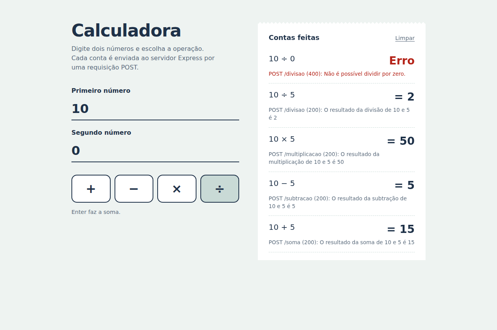
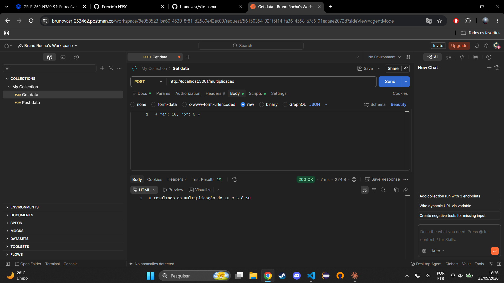

# site-soma

Exercício N390 — Requisições POST com Express no Node.js.

Servidor Express que recebe dois números (`a` e `b`) via POST em JSON e devolve o resultado das quatro operações matemáticas.

## Como executar

```bash
npm install
node app.js
```

O servidor sobe em `http://localhost:3001`. A raiz responde `Oi, mundo :-)` e a calculadora fica em `http://localhost:3001/calculadora`.

## Rotas

| Método | Rota             | Descrição                    |
|--------|------------------|------------------------------|
| GET    | `/`              | Responde `Oi, mundo :-)`     |
| GET    | `/calculadora`   | Front-end da calculadora     |
| POST   | `/soma`          | Retorna `a + b`              |
| POST   | `/subtracao`     | Retorna `a - b`              |
| POST   | `/multiplicacao` | Retorna `a * b`              |
| POST   | `/divisao`       | Retorna `a / b` (b ≠ 0)      |

## Testando no Postman

1. Método **POST**, URL `http://localhost:3001/soma`
2. Aba **Body** → **raw** → tipo **JSON**
3. Corpo:

```json
{
  "a": 10,
  "b": 5
}
```

Resposta esperada: `O resultado da soma de 10 e 5 é 15`

Repita trocando a rota para `/subtracao`, `/multiplicacao` e `/divisao`.

## Front-end

A pasta `public/` é servida pelo Express com `express.static` na rota `/calculadora`. A página tem dois campos numéricos e um botão para cada operação. Cada clique faz um `fetch` POST com JSON para a rota correspondente e mostra a resposta do servidor numa fita com o histórico das contas, incluindo os erros (como divisão por zero).



## Testes no Postman

Requisições feitas com o corpo `{ "a": 10, "b": 5 }`, todas com status `200 OK`.

### Soma


### Subtração


### Multiplicação


### Divisão

